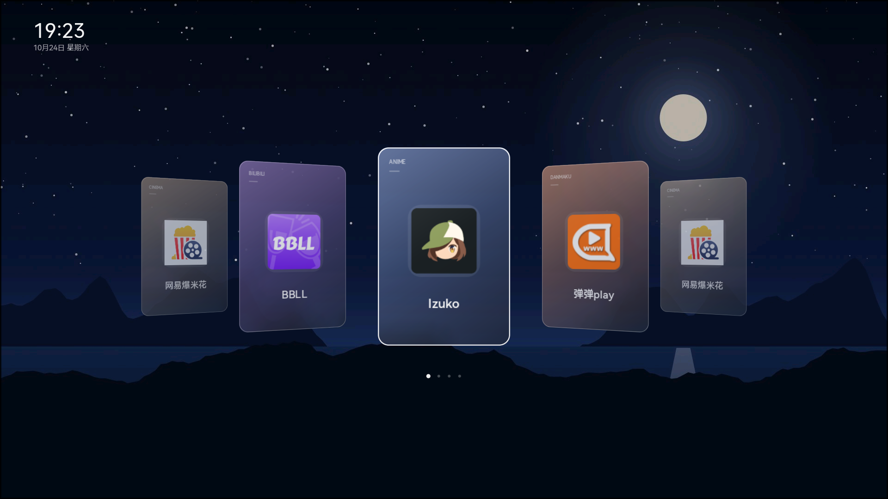

# XGIMI Home

An independent Android TV home app with a landscape wallpaper and a portrait Cover Flow carousel, made for remote control and tested on XGIMI G0043 (Android 11).

Application ID: **`com.gathin.tvhome`**. This repository contains only the extracted app,
not the full CleanYourTV toolkit. Version 2.6.4 restores the standalone project layout.
Install over the original package only with a matching signing key; private app data is retained.
The former `com.yikolemon.xgimihome` package is no longer built.



## Features

- Remote-first home screen: Left/Right browse, OK opens, Up opens the app library.
- Portrait translucent cards with app icons, a custom wallpaper, and a small clock.
- Bundled scenic wallpapers rotate sequentially every 30 minutes while Home is visible; the wallpaper page has an on/off switch.
- App library split into ordered Home apps and a multi-column list of other apps. OK opens any app; hold OK to add, remove, or reorder Home apps.
- Import one private wallpaper or choose a folder for rotation, with a built-in browser fallback on older TVs without a system folder picker.
- First wallpaper and app metadata load in the background. Startup has no loading text or breathing animation. The app library has no App info menu item.
- Personal wallpaper collections are not included in this repository or APK. Only the existing bundled scenic artwork is included.
- Small bounded artwork and icon caches; no image blur loop, network wallpaper, or system-partition changes.
- Does not silently set itself as the device's default Home app. Choose it manually in Android's Home app prompt/settings if desired.

## Build

Requires JDK 17 and Android SDK Platform 34.

```powershell
.\gradlew.bat assembleRelease testReleaseUnitTest
```

The APK is written to `app/build/outputs/apk/release/app-release.apk`.

## Install

```powershell
adb install -r app\build\outputs\apk\release\app-release.apk
```

Open it from the projector's app list first. Android may then offer to select a Home app; this project does not change that setting on its own.

## Theme and favourites

The built-in configuration and wallpaper are in `app/src/main/assets/`. To override them without rebuilding, place `config.json`, `wallpaper.jpg`, and optionally a `wallpapers/` folder in the app's external-files directory:

```text
/sdcard/Android/data/com.gathin.tvhome/files/
```

The included default theme is `THEME.md`. Favourite app package names and their display labels are in `app/src/main/assets/config.json`. The library remembers additions, removals, and ordering privately on the device.

## Notes

- Minimum Android version: 8.0 (API 26); tested on Android 11.
- App source is kept to the standalone Cover Flow home, app library, wallpaper import, and the small support code those features need.
- The release build uses the local debug signing key for sideloading; use your own release key for publishing signed releases.

## License

MIT. See [LICENSE](LICENSE).
