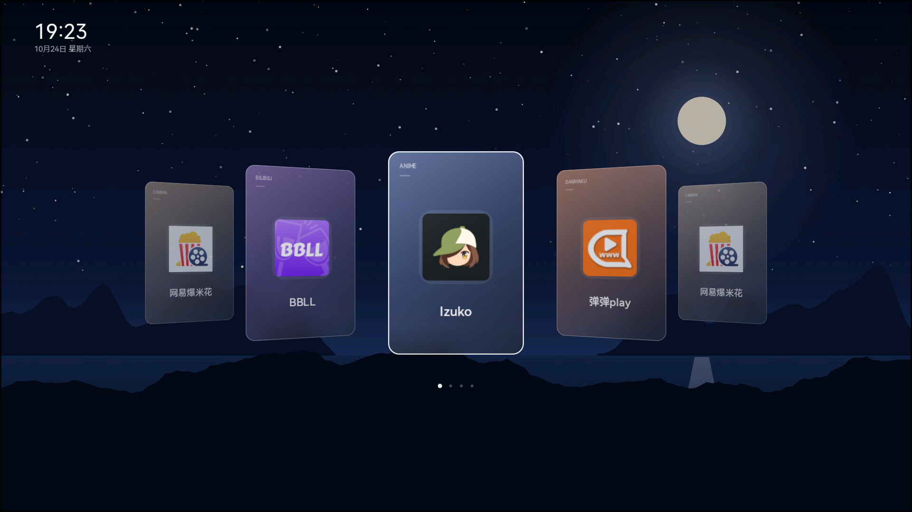

# XGIMI Home

[简体中文使用文档](README.zh-CN.md)

A lightweight, remote-first Android TV home launcher featuring a 3D Cover Flow carousel, customizable wallpapers, an organized app library, and a built-in local video screensaver. Designed for XGIMI projectors and Android TV devices (Android 8.0+, tested on Android 11 and TV API 36).

Application ID: **`com.gathin.tvhome`** · Current version: **2.7.0**



## Highlights

- **Smooth Cover Flow Home**: Velocity-preserving Cubic Hermite glide, continuous 3D card perspective, rounded app icons without background halos, zero full-screen overdraw over active wallpapers, and a deliberate long-press pace (~3 cards/sec) so every app stays easy to read.
- **Built-in App Library**: Split into your ordered Home carousel row and an alphabetical grid of all installed TV and mobile apps, with background scanning and icon decoding.
- **Custom Wallpapers & Rotation**: Ships with 14 scenic wallpapers (rotating every 30 minutes by default), plus single-image and folder batch import with automatic EXIF orientation normalization.
- **Local Video Screensaver**: Play videos directly from USB drives, local folders, or the app video folder without copying files—complete with in-player video switching and persistent **0%–100% screensaver volume**.
- **Small Footprint**: ~1.1 MB release APK, ~26 MB runtime PSS memory, zero background services, and no silent hijacking of the system default launcher.

---

## Installation

1. Download the release APK (`XGIMI-CoverFlowHome-v2.7.0.apk` or `app-release.apk`) from the [Releases](https://github.com/yikolemon/XGIMI-CoverFlowHome/releases) page, or install via ADB:

   ```powershell
   adb install -r app\build\outputs\apk\release\app-release.apk
   ```

2. Open **XGIMI Home** from your projector/TV app drawer.
3. Optional: Set it as your default launcher in Android TV system settings (the app never changes the default Home setting automatically).

> Upgrade note: Installing over an existing `com.gathin.tvhome` package requires a matching signing key to retain private settings and saved app order.

---

## How to Use (Remote Control Guide)

### 1. Home Screen (Cover Flow Carousel)

| Remote Action | Function |
|---|---|
| **Left / Right** | Browse Home apps (hold to glide smoothly at ~3 cards/sec) |
| **OK / Enter** | Launch the centered app |
| **Up** | Reveal and focus the top-right **All Apps** button |
| **OK** *(on top-right button)* | Open the **All Apps & Favorites** library |
| **Long-press OK** *(on top-right button)* | Open **Wallpaper & Screensaver Settings** |
| **Up × 3** *(within 2s, on top-right button)* | **Start Video Screensaver immediately** |

### 2. All Apps & Favorites Library

- **Top row**: Apps pinned to your Home Cover Flow carousel, shown in your custom order.
- **Bottom grid**: All other launchable apps installed on the device.
- **OK**: Launch any app directly.
- **Long-press OK** *(on any app)*: Open the action menu to **Add to Home**, **Remove from Home**, or **Reorder Home Position** (`Left / Right` to shift, `OK` to save, `Back` to cancel).

### 3. Wallpaper Settings

Open by **long-pressing OK** on the top-right Home button (or sharing an image to XGIMI Home):

- **Choose local image**: Pick a single image; automatically scaled and EXIF-rotated to fit your screen.
- **Choose wallpaper folder**: Import up to 100 images from a folder with EXIF orientation normalization.
- **30-minute wallpaper rotation**: Toggle automatic rotation on or off. Turning rotation off freezes the current collection instead of falling back to a single default image.
- **Restore built-in theme**: Switch back to the 14 bundled scenic wallpapers at any time.

### 4. Local Video Screensaver

Open **Wallpaper Settings → Video screensaver** to configure:

- **Choose video folder**: Grant persistent read-only access to a local or USB folder (or use the Media Library folder fallback / `/sdcard/Android/data/com.gathin.tvhome/files/screensaver/`). Supports `.mp4`, `.m4v`, `.webm`, `.mkv`, `.3gp`, and `.mov` (up to 20 videos sorted by filename, no sub-folders, no file copying).
- **Screensaver volume (`0%–100%`)**: Select default playback volume in `10%` steps.
- **Auto screensaver idle timeout**: Choose `Off`, `1`, `5`, `10` (default), `15`, `30`, or `60` minutes of inactivity on Home.
- **Refresh / Disconnect folder**: Rescan the folder after adding/removing files, or clear the folder binding without deleting any video files.

#### Controls While Screensaver Is Playing

| Remote Action | Function |
|---|---|
| **Down** | Open the bottom video chooser & **Screensaver Volume** bar |
| **Left / Right** *(on video row)* | Browse available videos (`OK` switches video) |
| **Down** *(from video row)* | Move focus to the **Screensaver Volume** bar (`Left / Right` adjusts in `10%` steps) |
| **Up** | Return focus to video row, or hide the chooser overlay |
| **Back** *(chooser open)* | Close the chooser overlay only (does not trigger exit confirmation) |
| **Double Back** *(within 600ms, chooser closed)* | Exit the screensaver back to Home |

> The chosen screensaver volume is remembered across video switches, screensaver exits, app restarts, and device reboots.

---

## Customization Without Rebuilding

Built-in defaults live in `app/src/main/assets/` (documented in [THEME.md](THEME.md)). To override them locally on your TV without rebuilding, copy `config.json`, `wallpaper.jpg`, and/or a `wallpapers/` folder to:

```text
/sdcard/Android/data/com.gathin.tvhome/files/
```

If an external `config.json` fails to parse, the launcher safely falls back to the built-in configuration.

---

## Build From Source

Requires JDK 17 (or Android Studio JBR) and Android SDK Platform 34:

```powershell
.\gradlew.bat testReleaseUnitTest assembleRelease -x lintVitalRelease -x generateReleaseLintVitalReportModel
```

The release APK is output to `app/build/outputs/apk/release/app-release.apk`.

> Note: Release builds currently use the debug signing key for sideloading convenience. Configure your own signing key before publishing to app stores.

---

## Documentation

- [简体中文使用指南](README.zh-CN.md)
- [Built-in Theme Guide](THEME.md)
- [Cold-Start & Performance Design](docs/cold-start.md)
- [Local Video Screensaver Spec](docs/screensaver.md)

## License

MIT. See [LICENSE](LICENSE).
