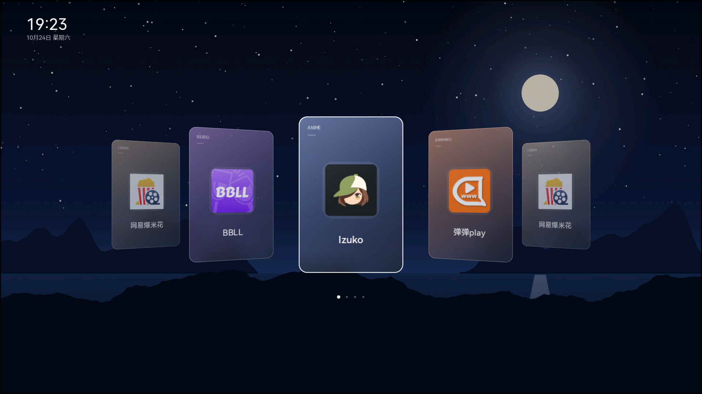

# XGIMI Home（极米 Cover Flow 桌面）

[English Documentation](README.md)

一款专为极米投影仪及 Android TV 遥控器打造的轻量级独立桌面应用。采用横屏背景壁纸搭配竖版 3D Cover Flow 应用卡片，内置本地壁纸轮换、应用库排序管理与本地视频屏保功能（支持 Android 8.0+，已在 Android 11 及 Android TV API 36 上实测）。

- **应用包名**：`com.gathin.tvhome`
- **当前版本**：**v2.7.0**
- **核心特点**：安装包仅约 `1.1 MB`、常驻内存约 `26 MB`、无后台常驻服务、不会擅自篡改系统默认桌面。



---

## 快速安装与启用

1. 从 [Releases 页面](https://github.com/yikolemon/XGIMI-CoverFlowHome/releases) 下载最新安装包（如 `XGIMI-CoverFlowHome-v2.7.0.apk`），复制到 U 盘在投影仪上安装，或通过 ADB 安装：

   ```powershell
   adb install -r XGIMI-CoverFlowHome-v2.7.0.apk
   ```

2. 安装完成后先从投影仪应用列表里打开一次 **XGIMI Home**。
3. 如需设为开机默认桌面，请在系统设置或桌面弹窗中手动选择（本应用不会强行接管系统 Home）。

> 提示：若设备中已装有旧版 `com.gathin.tvhome`，请使用相同签名密钥安装包覆盖升级以保留个人壁纸、应用排序与屏保配置。

---

## 使用指南（遥控器全操作）

### 一、主界面（Cover Flow 卡片桌面）

| 遥控器按键 | 操作说明 |
|---|---|
| **左 / 右方向键** | 切换首页应用卡片；长按约每秒 3 张匀速平稳滑动，方便看清每个应用 |
| **确认键（OK）** | 启动当前居中的应用 |
| **上方向键** | 显示并选中右上角应用库圆钮 |
| **确认键** *(聚焦右上角圆钮时)* | 打开 **全部应用与首页管理** 弹窗 |
| **长按确认键** *(聚焦右上角圆钮时)* | 打开 **壁纸与视频屏保设置** |
| **连续按 3 次上键** *(聚焦右上角圆钮后 2 秒内)* | **立即手动进入本地视频屏保** |

---

### 二、应用库与首页排序管理

在首页按 **上方向键** → **确认键** 即可打开：

- **上方“首页应用”列表**：展示当前 Cover Flow 桌面上显示的应用及序号。
- **下方“其他应用”网格**：展示本机所有已安装的 TV 应用与手机应用。
- **短按确认键**：直接打开任意应用。
- **长按确认键** *(选中任意应用)*：弹出操作菜单：
  - **添加到首页 / 从首页移除**：自由增删首页卡片；
  - **调整首页位置**：进入排序模式后，按 **左 / 右键** 移动位置，按 **确认键** 保存，按 **返回键** 取消。

---

### 三、壁纸设置与定时轮换

在首页按 **上方向键** 选中右上角按钮后 **长按确认键** 进入壁纸设置：

- **选择单张本地图片**：选定后自动按屏幕比例裁剪并修复手机拍照 EXIF 旋转方向，保存在应用私有目录。
- **选择本地壁纸文件夹**：一次导入文件夹内最多 100 张图片作为私有轮换壁纸集，导入时自动完成 EXIF 方向矫正。
- **壁纸定时轮换开关**：默认每 30 分钟按顺序切换内置 14 张风景壁纸；关闭开关后将保持在当前壁纸合集静态展示，不再退回单张默认图。
- **恢复内置主题壁纸**：随时一键切回应用内置风景壁纸集。

---

### 四、本地视频屏保（睡前/闲置播放）

在 **壁纸设置 → 视频屏保** 中可完成全部配置：

#### 1. 屏保设置项
- **选择视频文件夹**：通过系统目录选择器或电视媒体库文件夹列表绑定任意本地/U 盘目录（只申请只读权限，直接播放原视频、不复制占用空间）。也可手动将视频放到 `/sdcard/Android/data/com.gathin.tvhome/files/screensaver/` 后选择使用应用视频目录。支持 `.mp4`、`.m4v`、`.webm`、`.mkv`、`.3gp`、`.mov`，按文件名排序读取前 20 条（不含子文件夹）。
- **屏保音量**：支持 `0% ~ 100%`（按 `10%` 步进选择），默认 `100%`。
- **自动屏保无操作时长**：可选关闭、1、5、10（默认）、15、30 或 60 分钟。仅在桌面可见且无弹窗时计时，有遥控器按键即重新计时。
- **刷新本地视频目录**：增删目录内视频文件后手动重新扫描数量。
- **取消文件夹绑定**：解除当前目录关联并清空缓存计数（**绝不会删除**原视频文件）。

#### 2. 屏保播放界面遥控操作

| 遥控器按键 | 操作说明 |
|---|---|
| **下方向键** | 呼出底部**选片与音量控制浮层**（无操作 8 秒自动收起） |
| **左 / 右键** *(在视频缩略图行)* | 浏览目录内视频，按 **确认键** 切换播放（确认当前正在播放的视频不会重新从头放） |
| **下方向键** *(从视频行再按下)* | 焦点切到视频下方的 **屏保音量条** |
| **左 / 右键** *(在音量条上)* | 以 `10%` 步进实时调整音量（`0% ~ 100%`），也支持触摸点击 `−` / `+` |
| **上方向键** | 从音量条返回视频行；在视频行时按上键直接收起浮层 |
| **返回键** *(浮层打开时)* | **仅收起浮层**，不会计入退出屏保按键次数 |
| **连续按两次返回键** *(浮层收起时，600ms 内)* | 退出视频屏保并返回桌面 |

> **记忆特性**：你在屏保浮层或设置页里调整过的「屏保音量」和「上次播放的视频」，在切换下一条视频、退出屏保或重启设备后都会自动保留。

---

## 进阶：免重新编译自定义配置

无需改代码打包，将自定义 `config.json`、壁纸 `wallpaper.jpg` 或 `wallpapers/` 文件夹放到设备目录即可生效：

```text
/sdcard/Android/data/com.gathin.tvhome/files/
```

- 常用配置字段详见 [THEME.md](THEME.md)（支持自定义默认应用 `dock_apps`、应用名称映射 `app_labels`、轮换间隔 `wallpaper_rotation_minutes`、排序方式 `sequential`/`shuffle`、压暗比例 `wallpaper_dim` 等）。
- 如果外部 `config.json` 格式损坏，应用会自动回退使用内置配置保证正常启动。

---

## 从源码构建

需要 JDK 17（或 Android Studio 自带 JBR）与 Android SDK Platform 34：

```powershell
.\gradlew.bat testReleaseUnitTest assembleRelease -x lintVitalRelease -x generateReleaseLintVitalReportModel
```

构建产物位于：`app/build/outputs/apk/release/app-release.apk`。

> 说明：当前 Release 构建默认使用工程内的 debug 签名以便侧载更新；如需公开发布或上架请配置自己的正式签名证书。

---

## 更多技术文档

- [主题与配置字段说明](THEME.md)
- [冷启动加载与性能边界](docs/cold-start.md)
- [本地视频屏保设计与自查记录](docs/screensaver.md)

## 开源协议

MIT，详见 [LICENSE](LICENSE)。
